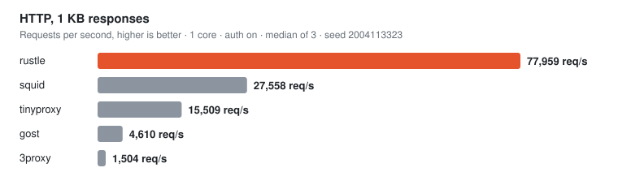
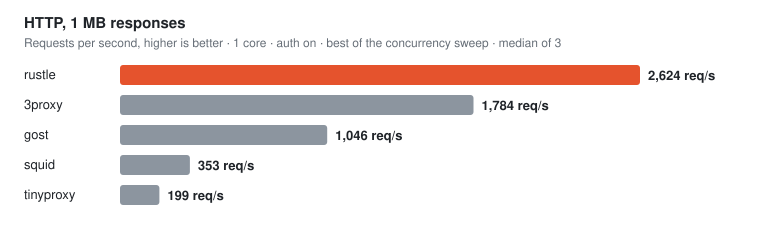
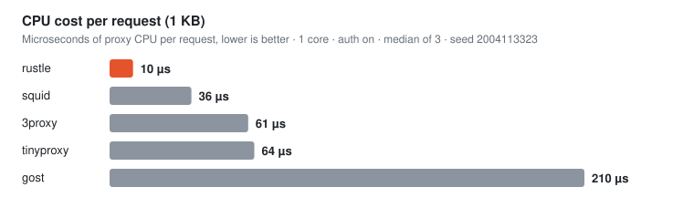
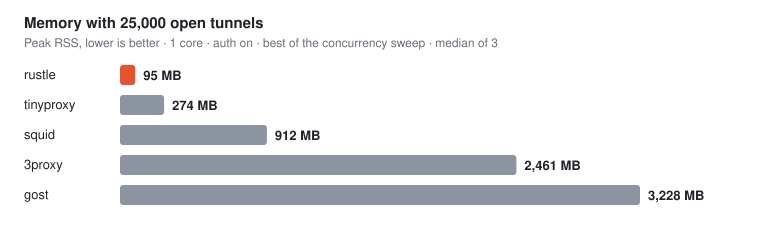
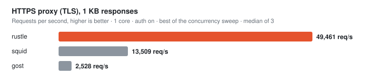
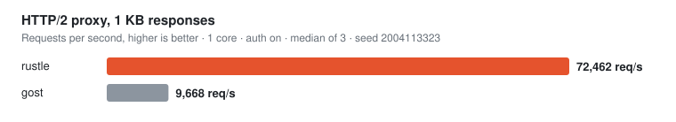
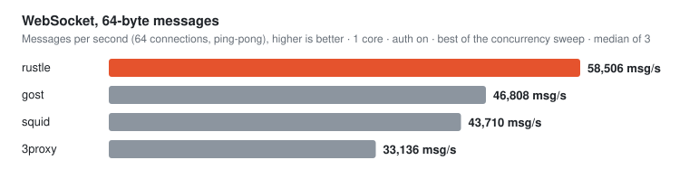

rustle
======

[](https://github.com/EdouardCourty/rustle/actions/workflows/ci.yml)
[](https://github.com/EdouardCourty/rustle/releases/latest)
[](LICENSE)

A high-performance forward proxy written in Rust. One binary serves HTTP/1.1 and HTTPS (`CONNECT`), an HTTPS proxy with HTTP/2, WebSocket upgrades and SOCKS5 (TCP and UDP). Each CPU core runs its own event loop, connection pool and sockets, so it scales with cores while staying light on memory, and it is safe by default.

```sh
curl -fsSL https://raw.githubusercontent.com/EdouardCourty/rustle/main/install.sh | sh
rustle init && rustle run
```

Linux and macOS, no `sudo`. [Benchmarks](#benchmarks) · [Installation](#installation) · [Quick Start](#quick-start) · [Configuration](#configuration)

Table of Contents
-----------------

*   [Benchmarks](#benchmarks)
*   [Under the Hood](#under-the-hood)
*   [Features](#features)
*   [Requirements](#requirements)
*   [Installation](#installation)
*   [Quick Start](#quick-start)
*   [Configuration](#configuration)
    *   [`[server]`](#server)
    *   [`[auth]`](#auth)
    *   [`[limits]` and `[timeouts]`](#limits-and-timeouts)
    *   [`[http]`](#http)
    *   [`[dns]`](#dns)
    *   [`[tls]`](#tls)
    *   [`[filter]`](#filter)
    *   [`[socks5]`](#socks5)
    *   [`[log]`](#log)
    *   [Certificate for the HTTPS port](#certificate-for-the-https-port)
*   [Reloading](#reloading)
*   [Limitations](#limitations)
*   [Contributing](#contributing)
*   [License](#license)

* * *

Benchmarks
----------

rustle against 3proxy, Squid, gost and Tinyproxy, each pinned to **one core** with authentication on, every competitor with the tuning its own documentation recommends, at the connection count where it performs best ([versions, settings and the A/B behind each one](bench/FAIRNESS.md)). Three bare-metal servers on a 25 Gbit/s private network (load generator → proxy → origin and sink, measured link 23.5 Gbit/s), the proxy on its own core of a 24-core EPYC. Fixed-seed shuffled test order, median of 3 runs, no error in any test.









<!-- bench:table:start -->

| 1 core | rustle | 3proxy | Squid | gost | Tinyproxy |
|---|---|---|---|---|---|
| 1 KB, req/s | **55,258** | 21,032 | 15,140 | 4,755 | 7,580 |
| 1 MB, req/s | **2,624** | 1,784 | 353 | 1,046 | 199 |
| 10 MB, req/s | **268** | 191 | 33 | 145 | 21 |
| Short connections, req/s | **27,827** | 5,132 | 7,804 | 4,780 | 7,584 |
| Tunnels, Gbit/s | **22.0** | 15.7 | 13.6 | 13.2 | 1.8 |
| 25,000 tunnels, RAM | **95 MB** | 2.4 GB | 912 MB | 3.2 GB | 274 MB |
| HTTPS, new connection, resumed, req/s | **6,119** | — | 2,047 | 2,516 | — |
| HTTPS, new connection, full handshake, req/s | **5,458** | — | 1,922 | 2,246 | — |
| WebSocket 64 B, msg/s | **58,506** | 33,136 | 43,710 | 46,808 | — |
| WebSocket 64 KB, Gbit/s | **11.6** | 7.9 | 6.6 | 6.9 | — |
| WebSocket handshakes/s | **10,740** | 251 | 4,879 | 3,726 | — |

<!-- bench:table:end -->

Reading the numbers:

*   **Small requests and memory are where rustle is far ahead**: 2.6× the next proxy (3proxy) at 1 KB, 2.1× at 10 KB, 3.6× on short connections (Squid), and 95 MB for 25,000 idle tunnels against 274 MB for the next one (Tinyproxy) and 0.9 to 3.2 GB for the others.
*   **Bulk transfers and tunnels reach the network**: at 1 MB, 10 MB and in tunnels rustle runs at about 22 Gbit/s of the 23.5 Gbit/s link, so its lead there is a lower bound. On tunnels it spends about half the CPU per GB of 3proxy (259 against 524 ms/GB).
*   **Multi-core**: 55,000 req/s per added core at 1 KB, linear up to 8 cores (439,740 req/s), 3.8× the next proxy at 8 cores ([curve](bench/RESULTS.md)).
*   **HTTPS, HTTP/2 and WebSocket**: ahead of Squid and gost on every test (49,461 req/s at 1 KB over TLS against 13,509 for Squid; 33,451 over HTTP/2 against 5,231 for gost). TLS and h2 carry no `splice`, so throughput is lower than in plain HTTP; on HTTP/2 tunnels the lead over gost is small (8.8 against 7.8 Gbit/s).
*   One campaign, one seed, noise ±3–5 %: differences below that are not conclusions. The workload is a static origin with `Content-Length` (no chunked bodies, uploads or SOCKS5): those are covered by the tests, not the bench.

Full tables, the TLS, HTTP/2, WebSocket and multi-core matrices, and the raw data: [`bench/RESULTS.md`](bench/RESULTS.md). To reproduce (Docker, Linux):

```sh
make bench P=rustle A=on      # one proxy (rustle|3proxy|squid|gost|tinyproxy)
make bench-all                # 5 proxies × plain / TLS / h2
make bench-ws P=rustle        # WebSocket matrix
make bench-publish           # campaigns → validity check → the SVGs and the table above
```

Under the Hood
--------------

*   **Shared-nothing, one core = one shard.** `workers` threads, each with its own single-threaded Tokio runtime, its own `SO_REUSEPORT` listener and its own upstream pool. A connection never leaves its core: no locks on the hot path, no work stealing, no cross-core wakeups (measured −11 % CPU per request on short connections against a multi-threaded runtime).
*   **Zero-copy relay.** Tunnels and large bodies move through `splice()` and pooled 1 MB pipes, so payload bytes never enter user space; small flows start with an adaptive copy and only switch when the flow is sustained.
*   **Allocation-free hot path.** Request heads are parsed in place (spans into the read buffer), scratch buffers live as long as the connection, and a keep-alive request costs about two `recv` and two `send` syscalls.
*   **Socket options set once.** `TCP_NODELAY`, `TCP_DEFER_ACCEPT` and 1 MB buffers are applied on the listener and inherited by every accepted socket: no per-request `setsockopt`.
*   **Optional extras.** `pin_cores` steers each connection to the shard of the CPU that received its SYN (`SO_ATTACH_REUSEPORT_CBPF`); `ktls` hands TLS sessions to the kernel after the handshake (5 to 20 % less memory, but slower than rustls on every throughput test with software kernel TLS, hence off by default).

Features
--------

*   **Protocols**: plain HTTP/1.1 (WebSocket upgrades included) and `CONNECT`, HTTP/1.1 over TLS, HTTP/2 over TLS (ALPN `h2`), SOCKS5 (`CONNECT` + `UDP ASSOCIATE` for QUIC/HTTP3 and DNS).
*   **Fast**: one shard per core, allocation-free hot path, zero-copy `splice()` relay on Linux. See [Benchmarks](#benchmarks).
*   **Light**: ~95 MB for 25,000 open tunnels.
*   **Safe by default**: API key auth, client IP allowlist, bans after repeated wrong keys, private and internal destinations refused (DNS rebinding included), allowed ports, anti-slowloris, anti request smuggling.
*   **Operable**: single static config file, access log that never blocks the proxy, `/health` endpoint, graceful shutdown, systemd/launchd service management, self-update.

Requirements
------------

*   Linux (x86_64, aarch64), glibc ≥ 2.35 (Debian 12, Ubuntu 22.04 or newer). This is the reference platform, with all the fast paths.
*   macOS (Apple Silicon, Intel): fully functional, without the Linux-only fast paths (`splice`, kTLS, core pinning). Linux is the reference platform.

Installation
------------

```sh
curl -fsSL https://raw.githubusercontent.com/EdouardCourty/rustle/main/install.sh | sh
```

The installer detects your system, verifies the release SHA-256, installs `rustle` into `~/.local/bin` (`/usr/local/bin` as root, or `RUSTLE_INSTALL_DIR`) and never uses `sudo`. Pin a version with `RUSTLE_VERSION=v1.0.0`. Release archives carry a GitHub build provenance attestation (`gh attestation verify rustle-<target>.tar.gz --repo EdouardCourty/rustle`).

From source:

```sh
cargo build --release -p rustle
./target/release/rustle init
```

Quick Start
-----------

```sh
rustle init                # config with a fresh API key (~/.config/rustle/config.toml)
rustle run                 # run in the foreground …
rustle service enable      # … or as a service (systemd user unit / launchd agent)
rustle status              # is it healthy?
rustle reload              # apply a config change without a restart
rustle update              # install the latest release
rustle uninstall           # remove the service and the binary
```

`rustle service enable --system` installs a system-wide systemd unit (dedicated `rustle` user, `/etc/rustle/config.toml`). `rustle check [CONFIG]` validates a config without starting the proxy.

Use it:

```sh
# HTTP / HTTPS through the plain port
curl -x http://127.0.0.1:8080 -U me:MY_KEY https://example.com

# HTTPS proxy ([tls] section), HTTP/1.1 then HTTP/2
curl --proxy https://proxy.example.org:8443 -U me:MY_KEY https://example.com
curl --proxy https://proxy.example.org:8443 --proxy-http2 -U me:MY_KEY https://example.com

# SOCKS5 ([socks5] section)
curl --socks5-hostname me:MY_KEY@127.0.0.1:1080 https://example.com
```

The API key is a long random string (`openssl rand -base64 32`); the user name is ignored. On the plain port and on SOCKS5 the key travels **in clear text**: expose those only on a trusted interface (loopback, VPN) and use the HTTPS port over the Internet. With `api_keys` empty, the proxy is an **open relay**.

Configuration
-------------

A single TOML file: `rustle run [CONFIG]`, or looked up in `./config.toml`, `~/.config/rustle/config.toml`, `/etc/rustle/config.toml`. Commented example: [`rustle/config.toml.example`](rustle/config.toml.example). An unknown or misplaced key fails the startup. Durations look like `"5s"`, `"1m"`. Apply a change without a restart with `rustle reload` (or `kill -HUP`, `systemctl reload rustle`): see [Reloading](#reloading).

### `[server]`

| Key | Default | Description |
|---|---|---|
| `listen` | `"0.0.0.0:8080"` | Plain port (HTTP + CONNECT), literal IP address |
| `workers` | `1` | Number of shards (one thread each); `0` = one per CPU |
| `pin_cores` | `false` | Pin shard *i* to CPU *i* and steer each connection to the shard of the CPU that received it (Linux) |
| `admin_listen` | `"127.0.0.1:8181"` | `GET /health`, no auth; `""` disables it |
| `control_socket` | `"auto"` | Unix socket (mode 0600) for `rustle reload`: `/run/rustle/rustle.sock` as root, else `$XDG_RUNTIME_DIR/rustle.sock`, else next to the user config; `""` disables it |
| `socket_buffer_bytes` | `0` | `SO_SNDBUF`/`SO_RCVBUF` of relayed sockets; `0` = kernel autotuning. A fixed size (e.g. `1048576`) caps a 100 ms RTT link at ~80 Mbit/s and, on the loopback, can stall bulk flows for seconds |

### `[auth]`

| Key | Default | Description |
|---|---|---|
| `api_keys` | `[]` | Accepted keys; **empty = no authentication** |
| `allow_clients` | `[]` | IPs/CIDRs allowed to connect; empty = everyone. Others are closed at accept |
| `max_failures` | `5` | Wrong keys tolerated per IP within the window; `0` = no ban |
| `failure_window` | `"1m"` | Counting window |
| `ban_duration` | `"15m"` | Ban duration |

A request without credentials (a browser's first 407) does not count as a failure.

### `[limits]` and `[timeouts]`

| Key | Default | Description |
|---|---|---|
| `limits.max_connections` | `10000` | Concurrent client connections (all shards); beyond: 503 |
| `limits.max_header_bytes` | `65536` | Max request head size (431) |
| `timeouts.connect` | `"5s"` | Connection to the origin (504) |
| `timeouts.idle` | `"60s"` | Inactivity on a connection or tunnel |
| `timeouts.request_head` | `"10s"` | Total time to receive a request head or SOCKS5 handshake |

### `[http]`

| Key | Default | Description |
|---|---|---|
| `upstream_keepalive` | `true` | Reuse connections to origins |
| `max_idle_per_origin` | `1024` | Idle connections kept per origin and per shard (16× that across all origins); a connection idle for over 15 s is closed instead of reused |
| `max_request_body_bytes` | `0` | Max request body (413); `0` = unlimited |
| `max_response_body_bytes` | `0` | Max response body (502 when declared, cut otherwise); `0` = unlimited |
| `allow_websocket` | `true` | Let `Upgrade: websocket` requests on the plain-HTTP path through (the connection becomes a tunnel once the origin answers 101); `false` refuses them with 403. `CONNECT` tunnels (`wss://`) are opaque and not affected: limit them with `[filter] allowed_ports` |

### `[dns]`

| Key | Default | Description |
|---|---|---|
| `ttl` | `"60s"` | Lifetime of cached resolutions; `"0s"` disables the cache |
| `max_entries` | `4096` | Cache size |

### `[tls]`

HTTPS proxy and HTTP/2.

| Key | Default | Description |
|---|---|---|
| `listen` | `""` | `"IP:port"` of the HTTPS port, e.g. `"0.0.0.0:8443"`; empty = disabled. Needs `cert` and `key` |
| `cert` / `key` | `""` | PEM certificate chain and private key |
| `handshake_timeout` | `"10s"` | Max duration of a TLS handshake |
| `http2` | `true` | Offer HTTP/2 through ALPN |
| `ktls` | `false` | Kernel TLS (Linux, `tls` module). Saves some memory, slower than rustls on throughput without NIC TLS offload |

### `[filter]`

| Key | Default | Description |
|---|---|---|
| `block_private` | `true` | Refuse loopback, private, link-local, CGNAT, multicast and ULA destinations (403). Set `false` to reach your LAN |
| `deny` | `[]` | Extra refused networks (CIDR) |
| `allowed_ports` | `[]` | Allowed destination ports, e.g. `[80, 443]`; empty = all |

### `[socks5]`

| Key | Default | Description |
|---|---|---|
| `listen` | `""` | `"IP:port"` of the SOCKS5 port, e.g. `"127.0.0.1:1080"`; empty = disabled. The password is one of the `api_keys` |

### `[log]`

| Key | Default | Description |
|---|---|---|
| `access` | `"errors"` | `off`, `errors` (refusals and failures) or `all` (one line per request and tunnel) |
| `output` | `"file"` | `file` or `stdout` |
| `file` | `""` | Path when `output = "file"`; empty = no access log |
| `target` | `"host"` | Log `host:port` or the full URL (`url`) of `http://` requests |

One line per event: `2026-10-01T10:00:00.123Z client=1.2.3.4 via=http1 kind=connect target=example.com:443 status=200 up=773 down=5489 ms=43`. Rotate by renaming the file then `kill -HUP <pid>`. Diagnostics (`RUST_LOG`) go to stderr.

### Certificate for the HTTPS port

Use Let's Encrypt on the proxy's name (`cert = fullchain.pem`, `key = privkey.pem`), or a self-signed certificate / internal CA installed on your clients (browsers refuse untrusted HTTPS proxies). Prefer ECDSA P-256:

```sh
openssl req -x509 -newkey ec -pkeyopt ec_paramgen_curve:prime256v1 -nodes \
  -days 365 -subj /CN=proxy.example.org -keyout key.pem -out cert.pem
```

The certificate and the key are read at startup and again by `rustle reload` (or `SIGHUP`): after a renewal, reload, no restart needed. Connections already open keep the old certificate until they close; if the new files are unreadable or do not match, the reload fails and the running one stays.

Reloading
---------

```sh
rustle reload      # re-read the config file the proxy was started with
```

The file is validated first; if anything is wrong (syntax, a CIDR, a missing certificate, a key that does not match) the running config is kept and the error is printed. `SIGHUP` does the same (and reopens the access log), so `systemctl reload rustle` works.

*   **Applied to new connections**: `api_keys`, `allow_clients`, the ban settings, `[filter]`, `[limits]`, `[timeouts]`, `[dns]`, `http.max_*_body_bytes`, `http.allow_websocket`, `tls.cert` / `key` / `http2` / `handshake_timeout`. A renewed certificate is picked up without dropping anyone.
*   **Restart required**: `listen` addresses, `workers`, `pin_cores`, `socket_buffer_bytes`, `control_socket`, `tls.listen` / `ktls`, `socks5.listen`, `admin_listen`, the upstream pool and `[log]`. `rustle reload` lists the ones you changed and keeps their running value.
*   Connections already open keep the config they were accepted under until they close, so a revoked key stays valid on an existing keep-alive connection until it ends (at most `timeouts.idle` once idle).

Limitations
-----------

*   `Upgrade` is supported for WebSocket only (not `h2c` or other protocols), over HTTP/1.1 clients; WebSocket over HTTP/2 (RFC 8441) is not. `wss://` and browsers' `ws://` go through `CONNECT`.
*   Authentication is by API key: several keys can be configured, but there are no per-user accounts, per-user quotas or policies, and no LDAP/OIDC.
*   Pipelined client requests are answered one at a time, then the connection closes.
*   `Expect: 100-continue` is not fully supported.
*   No HTTP/3 to the proxy itself (QUIC traffic works through SOCKS5 UDP).
*   Towards origins, plain HTTP/1.1 only.

Contributing
------------

```sh
make check      # fmt + clippy (-D warnings) + tests + website data + quick e2e: before every commit
make e2e        # full black-box suite, ~530 scenarios (~2 min)
make help       # all targets
```

The e2e suite ([`e2e/`](e2e/README.md)) runs the real binary against real clients (HTTP/1.1, TLS, h2, SOCKS5, curl). A new feature or a bug fix comes with a scenario.

Commits follow Conventional Commits, subject only: `type(scope): description`, e.g. `perf(relay): per-shard pipe pool for splice`. Performance claims need a fixed-seed benchmark run. Architecture, invariants and benchmark rules for contributors and agents: [`AGENTS.md`](AGENTS.md).

License
-------

[MIT](LICENSE)
